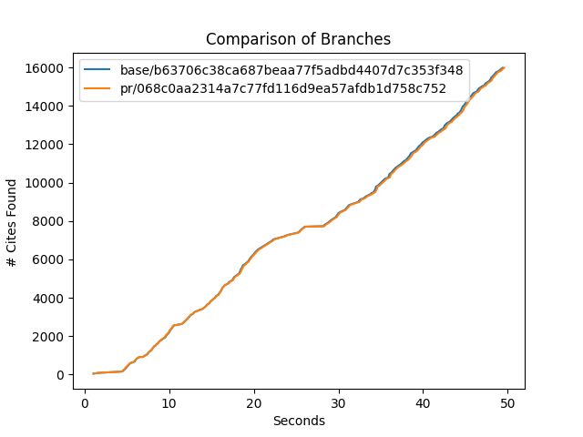

# The Eyecite Report :eye:

Gains and Losses
---------
There were 0 gains and 0 losses.

Total citations found: base **15988**, PR **15988** (net **+0**).

Click here to see details.

|     id     |  Gain  |  Loss  |
| ---------- | ------ | ------ |

Time Chart
---------

Generated Files
---------

[Base (main) Output](https://raw.githubusercontent.com/freelawproject/eyecite/artifacts/368/results/b63706c38ca687beaa77f5adbd4407d7c353f348.json)
[PR Output](https://raw.githubusercontent.com/freelawproject/eyecite/artifacts/368/results/068c0aa2314a7c77fd116d9ea57afdb1d758c752.json)
[Full Output CSV ](https://raw.githubusercontent.com/freelawproject/eyecite/artifacts/368/results/output.csv)
