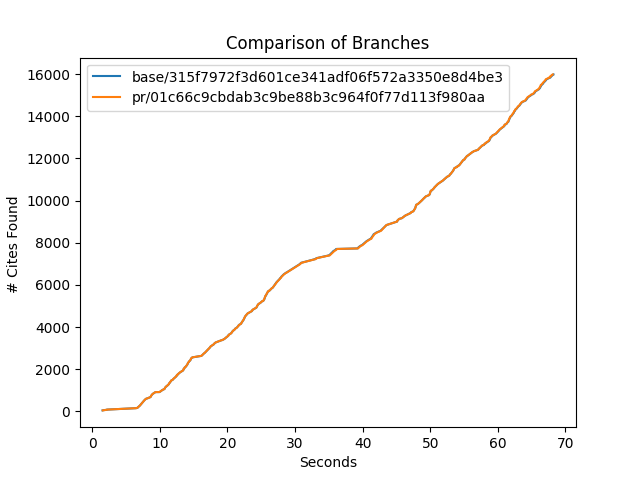

# The Eyecite Report :eye:

Gains and Losses
---------
There were 0 gains and 0 losses.

Total citations found: base **15988**, PR **15988** (net **+0**).

Click here to see details.

|     id     |  Gain  |  Loss  |
| ---------- | ------ | ------ |

Time Chart
---------

Generated Files
---------

[Base (main) Output](https://raw.githubusercontent.com/freelawproject/eyecite/artifacts/369/results/315f7972f3d601ce341adf06f572a3350e8d4be3.json)
[PR Output](https://raw.githubusercontent.com/freelawproject/eyecite/artifacts/369/results/01c66c9cbdab3c9be88b3c964f0f77d113f980aa.json)
[Full Output CSV ](https://raw.githubusercontent.com/freelawproject/eyecite/artifacts/369/results/output.csv)
