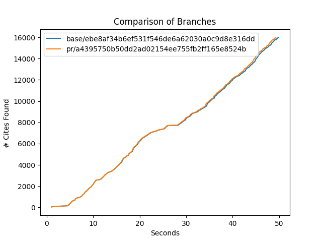

# The Eyecite Report :eye:

Gains and Losses
---------
There were 0 gains and 0 losses.

Total citations found: base **15988**, PR **15988** (net **+0**).

Click here to see details.

|     id     |  Gain  |  Loss  |
| ---------- | ------ | ------ |

Time Chart
---------

Generated Files
---------

[Base (main) Output](https://raw.githubusercontent.com/freelawproject/eyecite/artifacts/373/results/ebe8af34b6ef531f546de6a62030a0c9d8e316dd.json)
[PR Output](https://raw.githubusercontent.com/freelawproject/eyecite/artifacts/373/results/a4395750b50dd2ad02154ee755fb2ff165e8524b.json)
[Full Output CSV ](https://raw.githubusercontent.com/freelawproject/eyecite/artifacts/373/results/output.csv)
