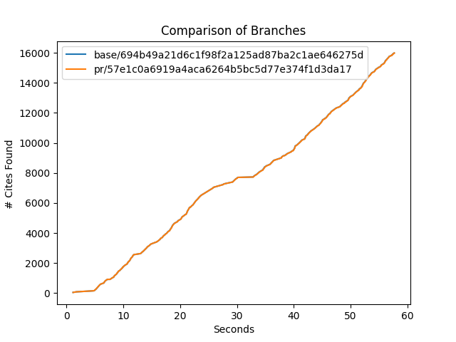

# The Eyecite Report :eye:

Gains and Losses
---------
There were 0 gains and 0 losses.

Total citations found: base **15988**, PR **15988** (net **+0**).

Click here to see details.

|     id     |  Gain  |  Loss  |
| ---------- | ------ | ------ |

Time Chart
---------

Generated Files
---------

[Base (main) Output](https://raw.githubusercontent.com/freelawproject/eyecite/artifacts/375/results/694b49a21d6c1f98f2a125ad87ba2c1ae646275d.json)
[PR Output](https://raw.githubusercontent.com/freelawproject/eyecite/artifacts/375/results/57e1c0a6919a4aca6264b5bc5d77e374f1d3da17.json)
[Full Output CSV ](https://raw.githubusercontent.com/freelawproject/eyecite/artifacts/375/results/output.csv)
